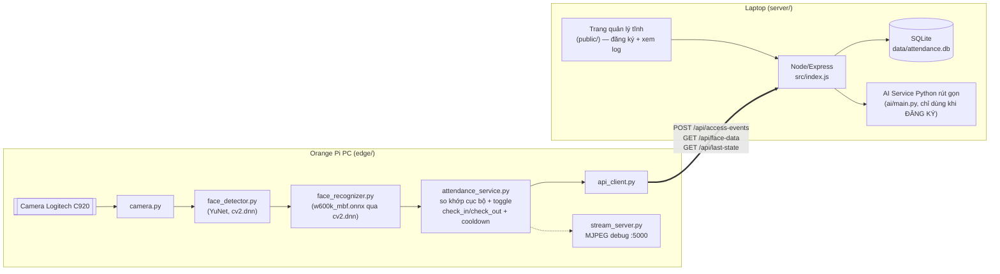
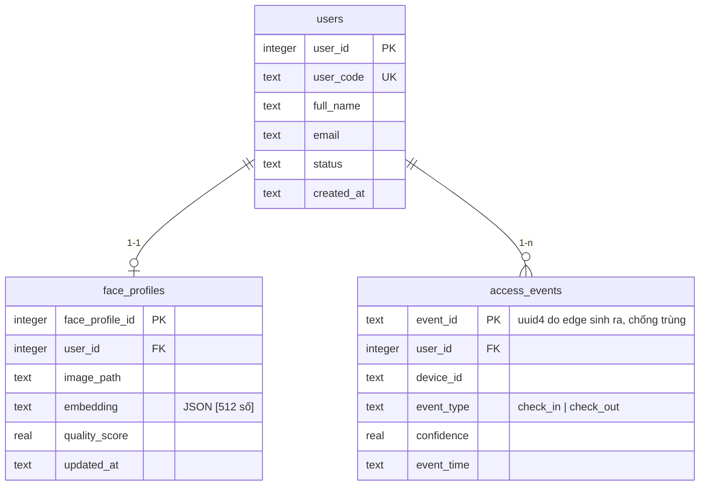
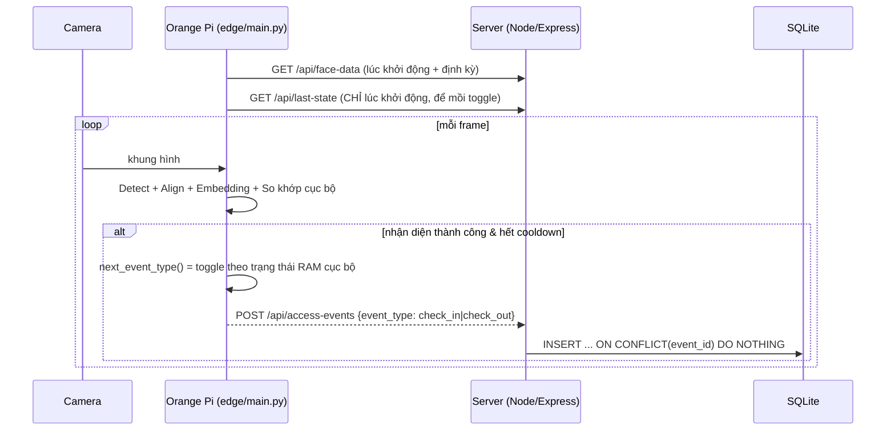

# Kiến trúc PoC — Lab Access (điểm danh ra/vào phòng lab bằng khuôn mặt)

> Thay thế hoàn toàn mô hình "điểm danh theo lớp/học phần/phiên" của project
> gốc bằng mô hình đơn giản hơn: 1 camera, 1 cửa, ghi log ra/vào (check-in/
> check-out) của từng người. Toàn bộ hệ thống nằm trong `AIOT/`, KHÔNG dùng
> lại `backend/`/`frontend/` gốc.

## 1. Kiến trúc tổng thể



## 2. Database — tối giản, 3 bảng (SQLite)

Không còn `classes/courses/lecturers/course_sections/enrollments/attendance_sessions`
của project gốc. Vector embedding lưu dạng `TEXT` (JSON của mảng 512 số) vì
SQLite không có kiểu vector, và cũng không cần — cosine similarity tính hết ở
edge (numpy), server chỉ lưu/trả lại nguyên embedding.



File: `server/src/schema.sql`.

## 3. Vai trò — chỉ còn admin & user

- **admin**: đăng nhập trang quản lý (1 mật khẩu, `ADMIN_PASSWORD` trong
  `server/.env`) — tạo người dùng, đăng ký khuôn mặt, xem log ra/vào.
- **user**: chỉ là bản ghi trong bảng `users` (người được nhận diện) — KHÔNG
  đăng nhập, không có tài khoản riêng. Không còn phân biệt lecturer/student
  hay quyền theo lớp/học phần như project gốc.

Không dùng JWT — token đăng nhập admin là chuỗi ngẫu nhiên lưu trong RAM của
server (`server/src/middleware/auth.js`), mất khi restart (chấp nhận được cho PoC).

## 4. API tối thiểu

| Method | Endpoint | Ai gọi | Mô tả |
|---|---|---|---|
| POST | `/api/auth/login` | Trang quản lý | Đăng nhập admin, trả về token |
| GET | `/api/users` | Trang quản lý (admin) | Danh sách người dùng |
| POST | `/api/users` | Trang quản lý (admin) | Tạo người dùng mới |
| POST | `/api/users/:code/face` | Trang quản lý (admin) | Upload ảnh → validate qua AI Service → lưu embedding |
| POST | `/api/access-events` | Edge (device key) | Gửi 1 sự kiện check_in/check_out |
| GET | `/api/access-events` | Trang quản lý (admin) | Xem log, lọc theo `user_code`/`from`/`to` |
| GET | `/api/face-data` | Edge (device key) | Tải embeddings về cache cục bộ |
| GET | `/api/last-state` | Edge (device key) | Trạng thái check_in/check_out gần nhất của mỗi người (mồi cache lúc edge khởi động) |
| GET | `/api/health` | Ai cũng gọi được | Health check |

### Payload sự kiện (edge → server)
```json
{
  "event_id": "b6f0b6b0-...-uuid4",
  "device_id": "ORANGE_PI_PC_01",
  "user_code": "NV001",
  "event_type": "check_in",
  "timestamp": "2026-07-14T08:15:30+07:00",
  "confidence": 91.2
}
```
So với payload mẫu gốc (`user_id/name/status:"check_in"`): đổi `user_id` →
`user_code` (khớp tên cột thật), bỏ `name` (server tự tra từ `user_code`), bỏ
`status` chung chung → tách rõ `event_type` là `check_in`/`check_out` do
**edge tự quyết định** (xem mục 5), `confidence` là % giống hệt cách project
gốc tính `similarityPercent`.

## 5. Luồng xử lý & logic check-in/check-out



**Quyết định check_in/check_out nằm hoàn toàn ở edge** (đúng như yêu cầu ban
đầu — thiết bị biên tự xử lý xong, chỉ gửi trạng thái cho server):
- `attendance_service.py:AttendanceDecision` giữ 1 dict trong RAM
  `{user_code: "check_in"|"check_out"}` = trạng thái hiện tại của từng người.
- Mỗi lần nhận diện thành công (và hết cooldown), gọi `next_event_type()`:
  chưa từng thấy hoặc lần trước là `check_out` → lần này là `check_in`;
  ngược lại → `check_out`. Đây là quy tắc đơn giản, không cần biết giờ giấc
  phiên/học phần như project gốc (không còn `compute_attendance_status()`).
- **Vấn đề khi restart**: cache RAM mất hết khi tiến trình edge khởi động
  lại → gọi `GET /api/last-state` 1 lần lúc khởi động để "mồi" lại đúng
  trạng thái từng người từ lịch sử đã lưu trên server.
- **Chống trùng khi mạng lag/retry**: `event_id` (uuid4, do edge sinh) là
  khoá chính của `access_events` — `INSERT ... ON CONFLICT DO NOTHING` nên
  gửi trùng 1 event_id không tạo dòng log kép. Đây là điểm khác với project
  gốc: không cần hàm `upsert_attendance_record()` phức tạp vì không còn ràng
  buộc "1 người/1 phiên" — chỉ là log lịch sử, mỗi sự kiện độc lập.

## 6. Trang quản lý (server/public/)

1 trang tĩnh (HTML/CSS/JS thuần, không build tool), 2 khu vực sau khi đăng nhập:
- **Đăng ký khuôn mặt**: nhập mã + tên người dùng → bật camera hoặc chọn ảnh
  → chụp → lưu (gọi `POST /api/users` rồi `POST /api/users/:code/face`).
- **Xem log**: bảng log ra/vào, lọc theo mã người dùng, làm mới thủ công.

## 7. So sánh với project gốc — cái gì bỏ, cái gì giữ

| Project gốc | PoC Lab Access | Ghi chú |
|---|---|---|
| `classes, courses, lecturers, course_sections, enrollments` | **Bỏ hẳn** | Không còn khái niệm lớp/học phần |
| `attendance_sessions` (draft/open/closed/submitted) | **Bỏ hẳn** | Không còn khái niệm phiên điểm danh |
| `attendance_records` + `upsert_attendance_record()` + `compute_attendance_status()` | Thay bằng `access_events` (INSERT đơn giản) | Không còn early/on_time/late — chỉ check_in/check_out |
| `students`, `face_profiles` (pgvector) | `users`, `face_profiles` (SQLite, embedding dạng JSON TEXT) | Đổi tên khái niệm student → user (generic) |
| Role admin/lecturer/student + JWT + ràng buộc theo lớp/học phần | Role admin/user, token đơn giản trong RAM | Giản lược tối đa |
| AI Service FastAPI đầy đủ (validate + extract + liveness) | AI Service rút gọn (validate + extract, bỏ liveness) | `server/ai/` |
| `FaceEngine` (detect+align+embedding+liveness) | Rút gọn bỏ liveness (`server/ai/core/face_engine.py`) | Model detect+embedding giữ nguyên |
| Trình duyệt tự chụp camera (`getUserMedia` trong `AttendanceScan.jsx`) | Camera vật lý gắn Orange Pi, xử lý AI hoàn toàn ở edge | Đúng tinh thần AIoT |
| So khớp bằng pgvector trong PostgreSQL | So khớp bằng numpy cosine ngay trên edge | Server không cần tính toán gì |
| React + Vite + TailwindCSS (frontend riêng) | 1 trang HTML/JS tĩnh do chính Node serve | Không cần dev server/build tool riêng |

## 8. Giới hạn (xem thêm `EDGE_DEPLOYMENT.md` mục 5)

Không có liveness, không đồng bộ offline phức tạp, 1 thiết bị/1 cửa, xác thực
tối giản (device key tĩnh + 1 mật khẩu admin), toggle check-in/check-out là
suy luận đơn giản (không xử lý ca đêm/qua ngày/nhiều cửa).
