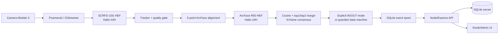

# Kế hoạch nâng cấp AttendanceSystem lên Raspberry Pi 5 + AI HAT+ 2

> Cập nhật: 05-10-2026  
> Phạm vi: PoC `AIOT/` (điểm danh/kiểm soát ra vào bằng khuôn mặt), không thay thế project `backend/` + `frontend/` cũ.  
> Mục tiêu phần cứng: chạy Computer Vision tại edge và **có khả năng nạp LLM**, nhưng không tích hợp LLM vào nghiệp vụ điểm danh ở giai đoạn này.

## 1. Kết luận ngắn gọn

Nên tiếp tục với cấu hình sau:

- Raspberry Pi 5 8 GB.
- Raspberry Pi AI HAT+ 2, Hailo-10H, 40 TOPS INT4, RAM riêng 8 GB.
- Camera Module 3 bản tiêu chuẩn.
- Active Cooler cho Raspberry Pi 5 và heatsink đi kèm AI HAT+ 2.
- Detector `SCRFD-10G`.
- Recognizer cuối cùng: `ms1mv3_r50` đã fine-tune/distill bằng `w600k_r50` trên dữ liệu Việt Nam, **chỉ khi model này vượt qua bộ kiểm thử độc lập và biên dịch Hailo thành công**.
- Baseline bắt buộc để so sánh: `arcface_r50` chính thức của Hailo Model Zoo trên Hailo-10H.
- Giữ server Node/Express + SQLite và API sự kiện hiện tại, nhưng thay lớp inference và cơ chế quản lý embedding/model.

Không nên triển khai thẳng model fine-tune vào vận hành. Thứ tự an toàn là:

1. Bring-up phần cứng và xác nhận Hailo-10H.
2. Chạy pipeline `SCRFD-10G + arcface_r50` chính thức của Hailo làm baseline.
3. Xuất và kiểm tra model fine-tune ở ONNX.
4. Biên dịch model đó sang HEF cho `hailo10h`.
5. So sánh FP32 ONNX, HEF quantized và dữ liệu camera thật.
6. Sinh lại toàn bộ embedding đăng ký bằng model cuối cùng.
7. Chỉ cut-over sau khi đạt tiêu chí sai số, độ trễ, nhiệt độ và độ ổn định.

## 2. Những gì đang có trong repository

### 2.1 Kiến trúc PoC hiện tại

`AIOT/` đang là một PoC tách biệt với hệ thống điểm danh theo lớp/học phần ở thư mục gốc:

```text
Camera Logitech C920
    -> Orange Pi PC
       - YuNet detection
       - w600k_mbf embedding bằng cv2.dnn
       - cosine matching cục bộ
       - toggle check_in/check_out
    -> HTTP REST qua LAN
    -> Laptop
       - Node/Express
       - SQLite
       - trang quản lý tĩnh
       - FastAPI dùng khi đăng ký khuôn mặt
```

Các file chính:

| Thành phần | File hiện tại | Nhận xét khi nâng cấp |
|---|---|---|
| Camera | `AIOT/edge/camera.py` | Đang dùng `cv2.VideoCapture` và dò `/dev/video*`; cần thêm backend Picamera2 cho Camera Module 3. |
| Detector | `AIOT/edge/face_detector.py` | Đang phụ thuộc `cv2.FaceDetectorYN` và output YuNet; cần adapter mới cho output SCRFD. |
| Alignment/recognizer | `AIOT/edge/face_recognizer.py` | Đang giả định row YuNet và chạy `w600k_mbf.onnx` bằng OpenCV DNN; cần tách preprocessing khỏi runtime và thêm Hailo backend. |
| Orchestrator | `AIOT/edge/main.py` | Có vòng lặp đồng bộ, xử lý mỗi N frame; cần chuyển sang pipeline có tracker/callback hoặc hàng đợi inference không chặn. |
| Matching/quyết định | `AIOT/edge/attendance_service.py` | Cosine matching dùng lại được; toggle vào/ra cần thay hoặc tăng kiểm soát. |
| Gửi sự kiện | `AIOT/edge/api_client.py` | Queue hiện nằm trong RAM; cần spool bền vững bằng SQLite nếu muốn chịu mất mạng/restart. |
| Health/stream | `AIOT/edge/health.py`, `stream_server.py` | Cần bổ sung trạng thái Hailo, model ID, nhiệt độ, queue depth; stream debug cần giới hạn truy cập. |
| Đăng ký khuôn mặt | `AIOT/server/ai/core/face_engine.py` | Đang dùng YuNet + `w600k_mbf`; bắt buộc đổi sang đúng recognizer/preprocessing của model edge mới. |
| Lưu embedding | `AIOT/server/src/schema.sql` | Chỉ lưu JSON embedding, chưa có `model_id`, `preprocess_id`, dimension hoặc trạng thái migration. |
| Phân phối embedding | `AIOT/server/src/routes/access-events.js` | API chưa chống việc edge nhận embedding thuộc model khác. |
| Triển khai | `AIOT/scripts/install_edge.sh`, `systemd/face-attendance-edge.service` | Đang viết cho Orange Pi ARMv7/OpenCV; cần viết lại cho Raspberry Pi OS 64-bit + HailoRT/TAPPAS. |

### 2.2 Trạng thái đã xác minh của PoC cũ

Theo `AIOT/HANDOFF.md`, Orange Pi đã chạy được YuNet, MobileFaceNet, cosine match, gửi event và MJPEG stream. Tuy nhiên còn các vấn đề:

- Similarity thực tế có lúc chỉ khoảng 46–53%; ngưỡng debug 0,45 đã được dùng để demo.
- Chưa có anti-spoofing/liveness trong PoC `AIOT/`.
- Queue mạng không bền vững.
- Toggle check-in/check-out dễ sai sau khi bỏ lượt, nhận nhầm hoặc qua ngày.
- systemd/reboot chưa được kiểm chứng hoàn chỉnh.
- Debug stream chưa có bảo vệ truy cập.

Việc đổi phần cứng không tự sửa các lỗi nghiệp vụ trên. Chúng phải nằm trong kế hoạch nâng cấp.

## 3. Đánh giá bảng phần cứng đã cập nhật

[Google Sheet “Hardware Attendance System”](https://docs.google.com/spreadsheets/d/1-nyBbMty9ByYB1S8Yw0YU5ghF_hyEfhGVfVO2Uq9-oY/edit?gid=0#gid=0) hiện có 10 dòng hạng mục. Tổng công thức `SUM(G2:G11)` là **17.774.000 đ**. Dòng shipping và VAT tổng vẫn trống, vì vậy đây chưa chắc là giá all-in cuối cùng. Cột `Availability` hiện chỉ đánh dấu dòng Audio HAT, nhưng bảng chưa giải thích checkbox nghĩa là “đã có”, “không cần mua” hay “đã chọn”; kế hoạch này không suy diễn trạng thái mua hàng từ checkbox đó.

| Hạng mục | Lựa chọn | Đánh giá | Việc cần xác nhận |
|---|---|---|---|
| Core computer | Raspberry Pi 5 8 GB | Phù hợp | Dùng Raspberry Pi OS 64-bit Trixie. |
| AI kit | Raspberry Pi AI HAT+ 2 | Đúng với yêu cầu LLM-capable | Phải là **AI HAT+ 2/Hailo-10H**, không nhầm AI HAT+ Hailo-8/8L hoặc AI Kit cũ. |
| Nguồn | Waveshare 27 W USB-C, 5.1 V/5 A | Về thông số là phù hợp | Kiểm tra thật sự đàm phán được 5 V/5 A với Pi 5; theo dõi undervoltage. Ưu tiên nguồn Raspberry Pi 27 W chính hãng nếu có thể. |
| Màn hình | Waveshare IPS 7 inch 1024×600 | Đủ cho kiosk | Xác nhận cách cấp nguồn màn hình. Nên cấp riêng nếu màn hình + touch làm giảm headroom nguồn của Pi. |
| Audio HAT | Không mua | Hợp lý | Dự án hiện không cần âm thanh. Header loa trên màn hình không đồng nghĩa đã có loa/ampli hoàn chỉnh. |
| Camera | Raspberry Pi Camera Module 3 | Phù hợp | Xác nhận bản standard hay wide. Với kiosk một người, bản standard thường ít méo mặt hơn. |
| Cooling | Raspberry Pi 5 Active Cooler | Bắt buộc trên thực tế | Gắn thêm heatsink đi kèm AI HAT+ 2. |
| Storage | Samsung PRO Plus microSD 128 GB | Đủ cho PoC | Dùng A2/high-endurance nếu ghi log nhiều. Không lưu dataset training trên Pi. |
| Camera cable | Cáp FPC camera Raspberry Pi | Chưa đủ thông tin | Pi 5 dùng đầu camera **mini 22-pin**; Camera Module 3 dùng đầu standard 15-pin. Cần đúng cáp 22-pin-to-15-pin, đúng chiều và đủ dài. |
| Camera enclosure | Vỏ Camera Module 3 | Hợp lý | Kiểm tra không che autofocus, không gây phản xạ hồng ngoại/ánh sáng và có góc chỉnh. |

### 3.1 Những món còn thiếu hoặc nên bổ sung

1. Vỏ/kết cấu cơ khí tương thích đồng thời Pi 5, Active Cooler, AI HAT+ 2, heatsink HAT và cáp camera.
2. Cáp micro-HDMI-to-HDMI phù hợp màn hình.
3. Nguồn/cáp riêng cho màn hình nếu màn hình không tự cấp nguồn qua phương án khác.
4. Nút nguồn hoặc cơ chế shutdown an toàn. Công tắc cắt nguồn trực tiếp có thể làm hỏng filesystem microSD.
5. Giá đỡ kiosk chống rung và cố định khoảng cách camera.
6. Tùy chọn RTC battery nếu thiết bị có thể mất mạng và vẫn cần timestamp đúng.
7. USB 3 SSD ngoài nếu cần log/video lớn. AI HAT+ 2 đã dùng PCIe của Pi, vì vậy không giả định có thể gắn thêm M.2 HAT+ NVMe trên cùng cổng mà không có thiết kế PCIe riêng.

### 3.2 Kết luận về yêu cầu “có thể tải LLM”

AI HAT+ 2 có Hailo-10H 40 TOPS INT4 và 8 GB RAM riêng. Raspberry Pi mô tả thiết bị này hỗ trợ LLM/VLM tới khoảng 6 tỷ tham số, tùy model và định dạng được Hailo hỗ trợ. Như vậy cấu hình đã đáp ứng yêu cầu phần cứng.

Điều này **không có nghĩa** mọi file GGUF/ONNX/Hugging Face đều được nạp trực tiếp. Model phải nằm trong Hailo GenAI Model Zoo hoặc có luồng chuyển đổi được Hailo hỗ trợ. Yêu cầu nghiệm thu ở dự án này chỉ nên là một smoke test tải và suy luận một LLM nhỏ được liệt kê bởi `hailo-ollama`; không đưa LLM vào service điểm danh.

Nguồn chính thức:

- [Raspberry Pi AI HAT+ 2: 40 TOPS, 8 GB RAM, LLM/VLM](https://www.raspberrypi.com/documentation/accessories/ai-hat-plus.html)
- [Raspberry Pi AI software và Hailo Ollama](https://www.raspberrypi.com/documentation/computers/ai.html)
- [Raspberry Pi AI HAT+ 2 product page](https://www.raspberrypi.com/products/ai-hat-plus-2/)

## 4. Quyết định model đề xuất

### 4.1 Detector: chọn SCRFD-10G

Đây là lựa chọn hợp lý cho dự án:

- Cho bounding box và 5 landmarks, phù hợp alignment ArcFace 112×112.
- Hailo Apps đã có pipeline face recognition dùng SCRFD và hỗ trợ `hailo10h`.
- Hailo Model Zoo có HEF Hailo-10H dựng sẵn.
- Theo benchmark model-zoo trên host tham chiếu, SCRFD-10G có hardware mAP 82,1 trên WIDER FACE, cao hơn SCRFD-2.5G 76,4.

Không dùng số FPS model-zoo làm cam kết FPS của kiosk. Các số đó đo trong điều kiện host/PCIe riêng, chưa gồm camera, resize, tracking, postprocess, render, database và API.

Baseline thay thế nếu cần giảm độ trễ/điện/nhiệt: `SCRFD-2.5G`. Chỉ hạ từ 10G xuống 2.5G sau khi đo rằng chất lượng detect mặt nhỏ/xiên/ngược sáng vẫn đạt yêu cầu.

Nguồn: [Hailo-10H face detection model list](https://github.com/hailo-ai/hailo_model_zoo/blob/master/docs/public_models/HAILO10H/HAILO10H_face_detection.rst).

### 4.2 Recognizer: chọn R50, nhưng phải qua cổng kiểm định

Ba ứng viên cần benchmark cùng một protocol:

| Model | Vai trò | Ưu điểm | Nhược điểm/quyết định |
|---|---|---|---|
| Hailo `arcface_r50` | Baseline chính | HEF Hailo-10H có sẵn; 112×112; model-zoo báo 99,7% LFW; giảm rủi ro bring-up | Chưa thích nghi riêng dữ liệu Việt Nam/camera kiosk. |
| `w600k_r50` | Teacher/reference | Chính là loại ResNet50@WebFace600K trong gói InsightFace `buffalo_l`; benchmark công khai mạnh | Model InsightFace public bị giới hạn non-commercial research nếu không có license khác. Không nên triển khai thương mại khi chưa rà license. |
| `ms1mv3_r50` fine-tune/distill trên VN-Celeb | Candidate cuối | Có khả năng tốt hơn trên miền khuôn mặt Việt Nam | Phải chứng minh trên tập test identity-disjoint và sau quantization Hailo; không được chỉ dựa vào training accuracy. |

Khuyến nghị cuối cùng:

- Giữ `SCRFD-10G`.
- Dùng Hailo `arcface_r50` để đưa phần cứng và pipeline lên trước.
- Sau đó thay riêng recognizer bằng `ms1mv3_r50` fine-tune nếu candidate vượt baseline ở tiêu chí TPR tại FMR mục tiêu, cross-condition và HEF-vs-ONNX consistency.
- Không triển khai teacher `w600k_r50` cùng lúc. Teacher chỉ phục vụ training/evaluation.
- Nếu candidate R50 không tốt hơn rõ ràng, dùng `arcface_r50` chính thức thay vì duy trì custom model phức tạp.

Nguồn:

- [Hailo-10H face recognition model list](https://github.com/hailo-ai/hailo_model_zoo/blob/master/docs/public_models/HAILO10H/HAILO10H_face_recognition.rst)
- [InsightFace model zoo và cấu hình buffalo_l](https://github.com/deepinsight/insightface/blob/master/model_zoo/README.md)
- [InsightFace license note cho public pretrained models](https://github.com/deepinsight/insightface/blob/master/server/docs/user-guide.md)

### 4.3 Lưu ý về tên `ms1mv3_r50` và quá trình distillation

Tên checkpoint không đủ để chứng minh model tương thích. Trước khi làm tiếp, phải tạo model card ghi rõ:

- Kiến trúc chính xác: iresnet50/ResNet50 variant nào.
- Input tensor: tên, shape, dtype, NCHW/NHWC.
- Input color: RGB hay BGR.
- Normalization: `(x - 127.5) / 127.5`, `x / 255`, hay chuẩn khác.
- Output dimension, thường là 512.
- Có BN/dropout/head classification nào còn nằm trong graph inference không.
- Loss gốc và loss fine-tune: ArcFace/CosFace/AdaFace, KD cosine, feature MSE, logit KD...
- Teacher checkpoint và license.
- Dataset, số identity, số ảnh, cách lọc trùng, cách chia train/val/test.
- Checksum SHA-256 của `.pth` và `.onnx`.
- Commit code dùng để export.

Teacher và student đều là R50 không đem lại lợi ích latency nếu kiến trúc giống nhau. Lợi ích kỳ vọng ở đây là domain adaptation/regularization, không phải model compression. Nếu mục tiêu là giảm tải thì student nên là MobileFaceNet/R18, nhưng với Hailo-10H dự án không cần hy sinh R50 chỉ để tiết kiệm compute.

### 4.4 VN-Celeb không được là bộ kiểm thử duy nhất

Tên “VN-Celeb” đang được dùng cho nhiều bộ dữ liệu khác nhau. Có repository `Vietnam-Celeb` về **speaker recognition**, trong khi VN-Celeb1 cho khuôn mặt được mô tả ở một số công trình là ảnh người nổi tiếng Việt Nam. Phải khóa rõ dataset ID, nguồn và license; không dùng tên chung chung trong model manifest.

Ngoài ra, ảnh người nổi tiếng thường khác camera kiosk về:

- Khoảng cách và kích thước mặt.
- Góc nhìn từ dưới/lệch.
- Ngược sáng, kính, khẩu trang.
- Motion blur và nén video.
- Camera/sensor/ISP.
- Độ tuổi và nhóm người thật sẽ dùng hệ thống.

Vì vậy cần một tập đánh giá camera thật, có đồng ý của người tham gia, tách identity khỏi training. Không lấy người dùng production làm test mà không có quy trình bảo vệ dữ liệu sinh trắc học.

## 5. Quy tắc không gian embedding — hạng mục P0

Embedding từ `w600k_mbf`, `w600k_r50`, `ms1mv3_r50` và HEF quantized **không được trộn** dù tất cả đều có 512 chiều.

Khi đổi recognizer:

1. Khóa `model_id` và `preprocess_id`.
2. Sinh lại embedding từ ảnh đăng ký bằng model mới.
3. Edge chỉ tải embedding có cùng `model_id` với HEF đang chạy.
4. Nếu model mismatch, health phải báo lỗi và chặn nhận diện; tuyệt đối không fallback im lặng.
5. Calibrate lại threshold. Không tái sử dụng `SIMILARITY_THRESHOLD=0.60` của MobileFaceNet cũ.

Ví dụ model ID:

```text
recognizer_model_id = arcface_iresnet50_vnceleb_kd_v1
recognizer_sha256   = <sha256-on-onnx>
hef_sha256          = <sha256-on-hef>
preprocess_id       = insightface_rgb_112_norm1275_v1
embedding_dim       = 512
detector_model_id   = scrfd_10g_h10_mz54
alignment_id        = arcface_5pt_112_v1
```

### 5.1 Schema migration khuyến nghị

Không overwrite embedding cũ ngay. Tạo bảng song song để rollback:

```sql
CREATE TABLE face_embeddings_v2 (
    embedding_id       INTEGER PRIMARY KEY AUTOINCREMENT,
    user_id            INTEGER NOT NULL REFERENCES users(user_id) ON DELETE CASCADE,
    model_id           TEXT NOT NULL,
    model_sha256       TEXT NOT NULL,
    preprocess_id      TEXT NOT NULL,
    alignment_id       TEXT NOT NULL,
    embedding_dim      INTEGER NOT NULL,
    embedding          TEXT NOT NULL,
    sample_count       INTEGER NOT NULL DEFAULT 1,
    quality_score      REAL,
    active             INTEGER NOT NULL DEFAULT 0 CHECK (active IN (0, 1)),
    created_at         TEXT NOT NULL DEFAULT (strftime('%Y-%m-%dT%H:%M:%S', 'now', 'localtime')),
    UNIQUE (user_id, model_id)
);

CREATE INDEX idx_face_embeddings_v2_model_active
ON face_embeddings_v2(model_id, active);
```

API `/api/face-data` nên yêu cầu `?model_id=...` và trả thêm metadata:

```json
{
  "status": "success",
  "model": {
    "model_id": "arcface_iresnet50_vnceleb_kd_v1",
    "preprocess_id": "insightface_rgb_112_norm1275_v1",
    "alignment_id": "arcface_5pt_112_v1",
    "embedding_dim": 512
  },
  "data": []
}
```

Edge phải từ chối response nếu metadata khác manifest cục bộ.

## 6. Kiến trúc đích



### 6.1 Phân chia trách nhiệm

**Raspberry Pi 5:**

- Camera capture.
- Detection, tracking, alignment, embedding.
- Quality gate.
- Matching cục bộ.
- Quyết định sự kiện.
- Cache embedding và queue sự kiện offline.
- Health/metrics.

**Laptop/server:**

- Đăng ký người dùng.
- Sinh embedding đăng ký bằng **cùng model logic** với edge.
- Quản lý model version và active embedding set.
- Lưu event, hiển thị log, quản trị.
- Phân phối embedding theo model ID.

**Không nằm trong đường critical path:**

- LLM.
- Training/fine-tuning.
- Hailo Dataflow Compiler.

Training và compile chạy trên workstation Ubuntu x86_64/WSL2 phù hợp yêu cầu Hailo, không chạy trên Raspberry Pi.

## 7. Lộ trình thực hiện chi tiết

## Giai đoạn 0 — Đóng băng baseline và artifact

Mục tiêu: có thể so sánh trước/sau và rollback.

Việc cần làm:

1. Tạo branch riêng cho migration Raspberry Pi/Hailo.
2. Chụp lại trạng thái hiện tại:
   - commit hash;
   - checksum hai ONNX đang dùng;
   - `.env` đã loại secret;
   - kết quả test Orange Pi hiện có;
   - schema SQLite;
   - danh sách user/embedding nhưng không commit dữ liệu sinh trắc học.
3. Tạo 20–50 clip ngắn từ Camera Module 3 hoặc thiết bị gần tương đương, có consent, gồm điều kiện sáng tốt, tối, ngược sáng, quay trái/phải, kính, khẩu trang, chuyển động.
4. Chốt metric và tiêu chí nghiệm thu ở mục 11 trước khi tune threshold.

Đầu ra:

- `benchmark/baseline.json`.
- `models/manifest.json`.
- Danh sách test case có mã ẩn danh.

Điều kiện hoàn tất: chạy lại được baseline cũ và biết chính xác model/preprocess nào tạo embedding.

## Giai đoạn 1 — Lắp ráp và bring-up Raspberry Pi 5

### 1.1 Lắp phần cứng

1. Tắt nguồn hoàn toàn.
2. Lắp Active Cooler lên Pi 5.
3. Cắm cáp Camera Module 3 trước khi lắp HAT.
4. Gắn heatsink đi kèm AI HAT+ 2.
5. Gắn stacking header, spacer, cáp PCIe và AI HAT+ 2 theo tài liệu Raspberry Pi.
6. Kiểm tra cáp camera không bị kẹp bởi HAT/vỏ.
7. Cắm màn hình và touch USB.
8. Chỉ cấp nguồn sau khi kiểm tra cực/cáp/ốc/spacer.

Raspberry Pi khuyến nghị dùng cả Active Cooler và heatsink AI HAT+ 2 cho workload nặng: [AI HAT hardware assembly](https://www.raspberrypi.com/documentation/accessories/ai-hat-plus.html#hardware-assembly).

### 1.2 Cài hệ điều hành

- Raspberry Pi OS 64-bit Trixie.
- Dùng hostname cố định, SSH key, timezone `Asia/Ho_Chi_Minh`.
- Tắt auto-login nếu kiosk không cần.
- Bật read-only/overlay filesystem chỉ sau khi pipeline ổn định; trước đó cần ghi log và debug.

### 1.3 Cài Hailo runtime đúng họ H10

```bash
sudo apt update
sudo apt full-upgrade -y
sudo apt install -y dkms hailo-h10-all
sudo reboot
```

Không cài đồng thời `hailo-all` và `hailo-h10-all`; tài liệu Raspberry Pi ghi hai package không thể cùng tồn tại.

Sau reboot:

```bash
uname -m
cat /etc/os-release
hailortcli fw-control identify
hailortcli --version
apt policy hailo-h10-all
```

Kỳ vọng:

- `uname -m` là `aarch64`.
- Hailo device được nhận là Hailo-10H.
- Không có lỗi firmware/PCIe.

### 1.4 Kiểm tra camera

```bash
rpicam-hello --list-cameras
rpicam-hello -t 5000
```

Sau đó ghi một clip test 1080p và một clip pipeline 1280×720 hoặc 640×640. Không chạy recognition trên full 12 MP.

### 1.5 Kiểm tra nguồn và nhiệt

```bash
vcgencmd get_throttled
vcgencmd measure_temp
```

Chạy tải 15–30 phút. `get_throttled` không được báo undervoltage/throttling. Nếu có:

1. Đổi sang nguồn Raspberry Pi 27 W chính hãng.
2. Cấp nguồn màn hình riêng.
3. Kiểm tra cáp và đầu nối.

## Giai đoạn 2 — Chứng minh Hailo CV và LLM độc lập

### 2.1 Cài Hailo Apps

Theo release tương thích với HailoRT đang cài:

```bash
git clone https://github.com/hailo-ai/hailo-apps.git
cd hailo-apps
sudo ./install.sh
source setup_env.sh
hailo-download-resources --list-models --arch hailo10h
hailo-download-resources --group face_recognition --arch hailo10h
```

Ghi lại version của HailoRT, TAPPAS, hailo-apps, model-zoo và checksum HEF. Không trộn tùy ý HailoRT 5.x, TAPPAS 5.x và model-zoo khác nhánh.

### 2.2 Chạy face recognition baseline của Hailo

```bash
hailo-face-recon --help
hailo-face-recon --input rpi --arch hailo10h --show-fps
```

Ứng dụng này còn được Hailo ghi là beta, nên dùng để xác nhận pipeline/model/postprocess, không bê nguyên database/logic của ứng dụng mẫu vào production.

Điều kiện hoàn tất:

- Camera chạy ổn định.
- SCRFD trả bbox + landmarks đúng.
- Recognizer trả embedding ổn định.
- Không tăng memory liên tục.
- Nhiệt độ không dẫn đến throttle.

### 2.3 Smoke test LLM — không tích hợp nghiệp vụ

Làm đúng hướng dẫn Hailo Ollama của Raspberry Pi cho phiên bản đang được hỗ trợ:

```bash
hailo-ollama
```

Ở terminal khác:

```bash
curl --silent http://localhost:8000/hailo/v1/list
```

Chọn model nhỏ có trong danh sách, tải model và gửi một prompt ngắn theo tài liệu chính thức. Ghi lại:

- model/tag;
- thời gian load;
- một response hợp lệ;
- RAM Pi và HAT;
- nhiệt độ;
- checksum/version package.

Sau test, dừng service. Không chạy LLM cùng service điểm danh ở nghiệm thu chính. Khả năng chạy đồng thời là một bài benchmark riêng, không được suy ra chỉ từ việc cả hai chạy riêng lẻ.

Điều kiện hoàn tất: có bằng chứng Hailo-10H load và suy luận một LLM được hỗ trợ. Đây là đủ cho yêu cầu “phần cứng tải LLM lên được”.

## Giai đoạn 3 — Chuẩn hóa model custom

### 3.1 Xuất ONNX

Model cuối phải có graph inference tĩnh:

```text
input:  float32 [1, 3, 112, 112]
output: float32 [1, 512]
layout: NCHW
```

Checklist:

- `model.eval()`.
- Bỏ classification head.
- Không có dropout/random op.
- Fixed batch 1 trước; chỉ dùng dynamic batch nếu Hailo flow đã được kiểm chứng.
- So output PyTorch và ONNX Runtime trên ít nhất 100 ảnh aligned.
- Cosine giữa embedding PyTorch/ONNX phải gần 1; mọi sai khác phải được giải thích.
- L2 normalization đặt rõ ở host hay graph, không làm hai lần ngoài ý muốn.

### 3.2 Tạo calibration set cho Hailo

Dùng ảnh face đã align 112×112, đại diện cho camera thật:

- nhiều mức sáng;
- da/tóc/kính/khẩu trang đa dạng;
- blur nhẹ;
- pose trong phạm vi cho phép;
- không lấy ảnh test identity-disjoint vào calibration nếu điều đó làm bẩn protocol đánh giá.

Calibration không phải fine-tuning. Không dùng ảnh quá sạch từ LFW làm calibration duy nhất nếu production là camera kiosk.

### 3.3 Biên dịch HEF trên workstation

Hailo Model Zoo yêu cầu môi trường Ubuntu 22.04/24.04 64-bit hoặc WSL2 phù hợp; GPU NVIDIA được khuyến nghị để tối ưu tốt. Dùng đúng DFC tương thích runtime Hailo-10H.

Template lệnh, cần điều chỉnh path và node names theo graph thật:

```bash
hailomz compile \
  --ckpt artifacts/arcface_iresnet50_vnceleb_kd_v1.onnx \
  --calib-path data/calibration_aligned_112 \
  --yaml hailo_model_zoo/cfg/networks/arcface_r50.yaml \
  --hw-arch hailo10h \
  --performance
```

Nếu parser không nhận graph:

1. Inspect input/output node names.
2. Thử `--start-node-names` và `--end-node-names` chính xác.
3. So graph với topology `arcface_r50` mà YAML mong đợi.
4. Không tự thay preprocessing cho tới khi biết normalization đang ở graph, ALLS hay host.
5. Lưu profiler report, HAR và log compile cùng manifest.

Nguồn: [Hailo ArcFace training/compile guide](https://github.com/hailo-ai/hailo_model_zoo/blob/master/training/arcface/README.rst) và [Hailo Model Zoo getting started](https://github.com/hailo-ai/hailo_model_zoo/blob/master/docs/GETTING_STARTED.rst).

### 3.4 Kiểm định quantization

So ba runtime trên cùng ảnh aligned:

1. PyTorch FP32.
2. ONNX Runtime FP32.
3. Hailo HEF quantized.

Không chỉ so cosine từng embedding. Phải so metric verification end-to-end:

- ROC.
- EER.
- TPR tại FMR 1%, 0,1% và nếu dữ liệu đủ lớn thì 0,01%.
- Genuine/impostor distributions.
- Threshold tốt nhất theo validation, rồi khóa threshold trước khi mở test set.
- Sai số theo ánh sáng, pose, kính, khẩu trang, khoảng cách.

Nếu HEF suy giảm đáng kể, sửa calibration/model optimization trước khi giảm threshold để “cho chạy”.

## Giai đoạn 4 — Refactor code edge

### 4.1 Tạo interface inference ổn định

Cấu trúc đề xuất:

```text
AIOT/edge/
├── inference/
│   ├── types.py                 # FaceDetection, EmbeddingResult
│   ├── preprocess.py            # color, resize, normalization, ArcFace alignment
│   ├── detector_base.py
│   ├── detector_hailo.py        # SCRFD HEF + postprocess
│   ├── detector_cpu.py          # YuNet fallback có kiểm soát
│   ├── recognizer_base.py
│   ├── recognizer_hailo.py      # R50 HEF
│   ├── recognizer_onnx.py       # test/reference, không phải production mặc định
│   └── manifest.py
├── model/
│   ├── manifest.json
│   ├── hailo10h/scrfd_10g.hef
│   ├── hailo10h/arcface_iresnet50_vnceleb_kd_v1.hef
│   └── onnx/arcface_iresnet50_vnceleb_kd_v1.onnx
└── tools/
    ├── compare_embeddings.py
    ├── benchmark_pipeline.py
    └── collect_calibration.py
```

Không để `main.py` biết chi tiết tensor names hoặc Hailo API.

### 4.2 Chuẩn hóa output detector

Hiện `align_face()` nhận row YuNet dạng:

```text
[x, y, w, h, x1, y1, ..., x5, y5, score]
```

SCRFD postprocess không đảm bảo đúng layout này. Tạo kiểu dữ liệu trung gian:

```python
@dataclass
class FaceDetection:
    bbox_xyxy: tuple[float, float, float, float]
    landmarks_5: np.ndarray  # shape (5, 2)
    score: float
```

Mọi detector convert sang `FaceDetection`. Alignment chỉ nhận kiểu này. Đây là thay đổi quan trọng để tránh đảo thứ tự landmark hoặc scale tọa độ sai.

### 4.3 Camera Module 3

Tạo `Picamera2Camera` song song với `OpenCVCamera`:

- Main stream cho display/record, ví dụ 1280×720 RGB/BGR.
- Lo-res stream cho detector nếu pipeline hỗ trợ.
- Khóa exposure/white balance sau warm-up nếu ánh sáng kiosk ổn định; nếu không, kiểm thử auto mode.
- Dùng timestamp monotonic cho cooldown và wall-clock ISO-8601 cho event.
- Không chuyển đổi RGB↔BGR nhiều lần.

### 4.4 Tracker và multi-frame consensus

Không nhận diện mọi bbox ở mọi frame. Đề xuất:

1. SCRFD detect.
2. Tracker cấp `track_id`.
3. Chỉ embedding khi mặt đủ lớn, đủ nét, pose hợp lệ và track ổn định N frame.
4. Lấy 3–5 embedding chất lượng, tính normalized centroid hoặc majority decision.
5. Chấp nhận nếu:
   - `top1 >= threshold`;
   - `top1 - top2 >= margin`;
   - đủ số frame đồng thuận;
   - quality gate đạt.
6. Cooldown theo user và track.

Cách này giảm false positive tốt hơn việc chỉ hạ/tăng một threshold.

### 4.5 Bỏ toggle mù

Logic hiện tại “lần sau đảo trạng thái lần trước” không đủ tin cậy. Chọn một trong ba phương án:

1. **Khuyến nghị cho kiosk:** màn hình có hai chế độ rõ ràng `CHECK IN` và `CHECK OUT`; người dùng/admin chọn, hoặc thiết bị được đặt cố định theo hướng cửa.
2. Hai vùng/đường ảo và tracking hướng di chuyển để suy ra vào/ra.
3. Hai camera hoặc cảm biến cửa nếu cần production.

Nếu vẫn giữ toggle cho demo:

- reset theo ngày/ca;
- yêu cầu dwell time;
- chặn đảo trạng thái từ cùng một track;
- hiện trạng thái hiện tại và yêu cầu xác nhận trên màn hình;
- ghi lý do quyết định vào event.

### 4.6 Queue sự kiện bền vững

Thay `queue.Queue(maxsize=50)` trong RAM bằng SQLite spool ở edge:

```text
pending_events(event_id PK, payload_json, created_at, attempts, next_retry_at, last_error)
```

Luồng:

- Ghi event vào SQLite trước.
- Worker gửi HTTP.
- Server trả 2xx/idempotent -> đánh dấu sent hoặc xóa.
- Retry exponential backoff có jitter.
- Giới hạn dung lượng và cảnh báo khi gần đầy.

`event_id` hiện đã giúp server chống trùng, nên phù hợp với at-least-once delivery.

### 4.7 Health và quan sát

`/health` cần thêm:

```json
{
  "camera": {"ok": true, "fps": 20.4},
  "hailo": {"ok": true, "arch": "hailo10h"},
  "models": {
    "detector": "scrfd_10g_h10_mz54",
    "recognizer": "arcface_iresnet50_vnceleb_kd_v1",
    "preprocess": "insightface_rgb_112_norm1275_v1"
  },
  "embeddings": {"loaded": 120, "model_match": true},
  "queue": {"pending": 0, "oldest_seconds": 0},
  "temperature_c": 61.2,
  "throttled": false
}
```

Không trả secret, embedding, ảnh mặt hoặc đường dẫn nội bộ nhạy cảm.

## Giai đoạn 5 — Đồng bộ luồng đăng ký khuôn mặt

Đây là điểm dễ bị bỏ sót nhất. Edge dùng HEF mới nhưng server hiện vẫn đăng ký bằng `AIOT/server/ai/core/face_engine.py` với YuNet + `w600k_mbf.onnx`.

### Phương án khuyến nghị

- Server đăng ký chạy bản ONNX FP32 của **cùng recognizer custom**.
- Detector có thể là SCRFD ONNX hoặc detector khác, miễn 5 landmarks được map và alignment giống hệt.
- Preprocessing dùng chung test vector với edge.
- Khi lưu, ghi `model_id`, checksum, preprocessing và dimension.
- Trước cut-over, tạo shadow embedding cho mọi user.
- So cosine embedding server ONNX và edge HEF trên cùng ảnh. Nếu khác quá mức, sửa pipeline hoặc calibrate threshold dựa trên cross-runtime thực tế.

### Cải thiện chất lượng template

Thay một ảnh bằng 5–10 frame đăng ký:

- mặt thẳng;
- quay nhẹ trái/phải;
- biểu cảm tự nhiên;
- có/không kính nếu thường dùng;
- loại frame blur/overexposure;
- tính normalized centroid từ các embedding đạt chuẩn.

Không giữ mọi ảnh thô vô thời hạn nếu không cần. Thiết lập retention và quyền truy cập dữ liệu sinh trắc học.

## Giai đoạn 6 — Calibrate threshold và đánh giá

### 6.1 Chia dữ liệu đúng

- Split theo **identity**, không split ngẫu nhiên theo ảnh.
- Không để cùng một người xuất hiện ở train và test.
- Deduplicate near-duplicate frames/video.
- Tập calibration threshold tách khỏi test cuối.
- Tập camera thật phải có impostor pairs đủ lớn.

### 6.2 Metric tối thiểu

| Metric | Ý nghĩa |
|---|---|
| Detection recall | Tỷ lệ frame/mặt đủ điều kiện được SCRFD phát hiện. |
| Landmark/alignment failure | Tỷ lệ crop sai, mắt/miệng đảo, crop ra ngoài. |
| FMR/FAR | Người sai được nhận thành người có trong hệ thống. Đây là rủi ro chính. |
| FNMR/FRR | Người đúng bị từ chối. |
| TPR@FMR | Chất lượng ở mức false match đã chọn. |
| EER | Chỉ để so model, không nhất thiết là threshold production. |
| Top-1/top-2 margin | Độ tách ứng viên tốt nhất và thứ hai. |
| End-to-end latency p50/p95 | Từ lúc mặt đủ điều kiện đến khi event được lưu. |
| Sustained FPS | FPS sau 30–60 phút, không chỉ lúc khởi động. |
| Temperature/throttle | Độ ổn định nhiệt. |
| Offline recovery | Không mất/nhân đôi event sau mất mạng/reboot. |

### 6.3 Không chọn threshold bằng vài ảnh demo

Quy trình:

1. Khóa model/preprocess.
2. Sinh genuine và impostor scores trên validation.
3. Chọn threshold theo FMR mục tiêu.
4. Chọn `top1-top2 margin` và N-frame consensus.
5. Khóa tất cả tham số.
6. Chạy một lần trên test set chưa xem.
7. Báo cáo CI nếu số pair đủ.

Ngưỡng 0,60 hiện tại chỉ là baseline lịch sử của MobileFaceNet cũ, không có giá trị mặc định cho R50 mới.

## Giai đoạn 7 — Liveness, an toàn và production hardening

### 7.1 Liveness

PoC hiện chấp nhận ảnh/video phát lại. Với điểm danh thật, đây là thiếu sót nghiêm trọng.

Thứ tự đề xuất:

1. Ngắn hạn: multi-frame challenge đơn giản, yêu cầu quay đầu/chớp mắt, kèm cảnh báo đây chưa phải anti-spoof mạnh.
2. Trung hạn: model RGB face anti-spoof có license rõ và compile được Hailo-10H.
3. Nếu mức bảo mật cao: thêm depth/IR hoặc camera phù hợp; Camera Module 3 RGB đơn lẻ không đảm bảo chống giả mạo mạnh.

Đánh giá liveness riêng với ảnh in, màn hình điện thoại, video replay và điều kiện ánh sáng thật.

### 7.2 Network và secret

- Không commit `.env`.
- Rotate `EDGE_DEVICE_KEY`.
- Thêm device identity và key riêng từng thiết bị nếu mở rộng.
- Dùng HTTPS/mTLS hoặc reverse proxy khi ra ngoài mạng demo kín.
- Giới hạn debug stream về localhost/VPN hoặc bắt buộc auth.
- Rate-limit login và endpoint đăng ký.
- Không log embedding/raw image.

### 7.3 systemd

Service mới phải:

- chạy bằng user riêng, thuộc group camera/video cần thiết;
- `Restart=on-failure`;
- có startup dependency phù hợp cho network và Hailo device;
- graceful SIGTERM;
- giới hạn log;
- health watchdog;
- không chạy hai instance giữ camera/Hailo cùng lúc.

Test ít nhất 10 vòng reboot và 10 vòng rút/cắm camera có kiểm soát.

## 8. Cấu hình phần mềm đề xuất

Ví dụ `.env.example` mới:

```env
CAMERA_BACKEND=picamera2
CAMERA_WIDTH=1280
CAMERA_HEIGHT=720
CAMERA_FPS=30

INFERENCE_BACKEND=hailo
HAILO_ARCH=hailo10h
DETECTOR_HEF_PATH=edge/model/hailo10h/scrfd_10g.hef
RECOGNIZER_HEF_PATH=edge/model/hailo10h/arcface_iresnet50_vnceleb_kd_v1.hef
MODEL_MANIFEST_PATH=edge/model/manifest.json

DETECTION_SCORE_THRESHOLD=0.50
MIN_FACE_SIZE_PX=80
MIN_SHARPNESS_SCORE=<CALIBRATE>
SIMILARITY_THRESHOLD=<CALIBRATE>
TOP1_TOP2_MARGIN=<CALIBRATE>
CONSENSUS_FRAMES=3

ATTENDANCE_MODE=explicit
ATTENDANCE_COOLDOWN_SECONDS=60

EVENT_SPOOL_PATH=data/events.db
SERVER_BASE_URL=http://<server-ip>:3001
DEVICE_ID=RPI5_H10_01
EDGE_DEVICE_KEY=<secret>
```

Không đưa giá trị giả `<CALIBRATE>` vào production. Startup phải fail-fast nếu tham số chưa được chốt.

## 9. Model manifest đề xuất

```json
{
  "schema_version": 1,
  "detector": {
    "model_id": "scrfd_10g_h10_mz54",
    "format": "hef",
    "sha256": "...",
    "input": {"shape": [1, 3, 640, 640], "color": "RGB"},
    "landmark_order": ["left_eye", "right_eye", "nose", "left_mouth", "right_mouth"]
  },
  "recognizer": {
    "model_id": "arcface_iresnet50_vnceleb_kd_v1",
    "format": "hef",
    "sha256": "...",
    "input": {"shape": [1, 3, 112, 112], "color": "RGB"},
    "normalization": "(x-127.5)/127.5",
    "alignment_id": "arcface_5pt_112_v1",
    "embedding_dim": 512,
    "l2_normalized_by": "host"
  },
  "runtime": {
    "target": "hailo10h",
    "hailort": "<pin>",
    "tappas": "<pin>",
    "model_zoo": "<pin>",
    "dataflow_compiler": "<pin>"
  }
}
```

Manifest phải được kiểm tra khi startup và hiển thị trong health.

## 10. Ma trận test bắt buộc

| Nhóm | Test | Pass criteria ban đầu |
|---|---|---|
| Hardware | Hailo identify sau cold boot | 10/10 boot nhận đúng Hailo-10H. |
| Power | Camera + CV + màn hình 60 phút | Không undervoltage/throttle. |
| Camera | Autofocus và capture nhiều khoảng cách | Không hunting liên tục; mặt đủ nét ở vùng vận hành. |
| Detector | 1 người, nhiều người, không người | Không phantom detection đáng kể; recall đạt mục tiêu đã chốt. |
| Landmark | Pose trái/phải, kính | Crop 112×112 đúng bằng kiểm tra ảnh trực quan. |
| Recognizer | Known/unknown identity-disjoint | Đạt FMR/FNMR mục tiêu. |
| Quantization | ONNX vs HEF | Không suy giảm metric vượt ngân sách đã chốt. |
| Model mismatch | Server embedding model A, edge model B | Edge fail-safe, không nhận diện. |
| Multi-frame | Đi ngang, đứng yên, quay đầu | Không gửi event từ một frame blur đơn lẻ. |
| Duplicate | Retry cùng event ID | Server chỉ có một event. |
| Network | Mất LAN 10 phút | Event nằm trong spool và gửi lại sau reconnect. |
| Restart | Reboot khi queue còn event | Event không mất, không nhân đôi. |
| Camera loss | Rút/cắm camera | Service recover hoặc báo degraded rõ ràng. |
| Thermal | 60 phút tải liên tục | Không throttle; p95 latency không trôi quá ngân sách. |
| UI | Touch 7 inch | Nút đủ lớn, feedback nhận diện rõ, không phụ thuộc hover. |
| LLM capability | Load 1 model Hailo hỗ trợ | Có response hợp lệ; ghi version/model/tag. |

## 11. Tiêu chí nghiệm thu đề xuất

Các con số dưới đây là điểm khởi đầu để nhóm chốt, không phải kết quả đã đạt:

- P95 từ mặt đủ điều kiện đến quyết định local: ≤ 500 ms.
- P95 từ quyết định local đến server ghi event khi LAN tốt: ≤ 1 s.
- Không mất event trong test mất mạng/reboot.
- Không có model mismatch im lặng.
- Không undervoltage/throttle trong 60 phút.
- Detection recall và recognition TPR đạt mức nhóm chốt trên tập camera thật.
- FMR phải được ưu tiên hơn việc “demo nhận được mọi người”.
- LLM smoke test pass độc lập.
- Có rollback về baseline HEF trước đó bằng một manifest/config switch có kiểm soát.

Không chốt con số accuracy chỉ từ LFW hoặc VN-Celeb. Báo cáo cả kết quả camera thật.

## 12. Thứ tự ưu tiên backlog

### P0 — phải làm trước khi thay model

1. Model manifest và versioning.
2. Baseline Hailo official SCRFD-10G + ArcFace R50.
3. Export/compile/validate custom R50.
4. Đồng nhất registration model và edge model.
5. Shadow migration/re-enroll embedding.
6. Calibrate threshold trên identity-disjoint set.
7. Chặn model mismatch.

### P1 — phải làm trước demo ổn định

1. Picamera2 backend.
2. Tracker + multi-frame consensus.
3. Event spool SQLite.
4. Sửa logic toggle hoặc dùng explicit IN/OUT.
5. Health Hailo/model/temperature/queue.
6. systemd + reboot recovery.
7. Bảo vệ debug stream.

### P2 — trước pilot thực tế

1. Liveness/anti-spoof.
2. Nhiều template đăng ký và quality gate.
3. HTTPS/device identity/key rotation.
4. Backup/restore database.
5. Retention và quyền truy cập dữ liệu sinh trắc học.
6. Remote update có rollback và artifact signing.

### P3 — ngoài phạm vi hiện tại

1. Tích hợp LLM vào sản phẩm.
2. Chạy LLM và CV đồng thời với QoS.
3. Nhiều thiết bị/nhiều cửa.
4. Fleet management/OTA.
5. VLM hoặc tìm kiếm video bằng ngôn ngữ.

## 13. Ước lượng thực hiện cho một người

| Giai đoạn | Ước lượng | Ghi chú |
|---|---:|---|
| Bring-up phần cứng + Hailo + camera | 1–2 ngày | Nếu không gặp lỗi cable/power/package. |
| Baseline Hailo face pipeline + LLM smoke test | 1–2 ngày | Chưa tích hợp code dự án. |
| Export/compile/custom model | 2–5 ngày | Có thể lâu hơn nếu graph/parser/quantization lỗi. |
| Refactor edge + camera + Hailo callback | 4–8 ngày | Phần code chính. |
| Schema/API/model migration | 2–4 ngày | Bao gồm rollback. |
| Dataset camera thật + calibration | 3–7 ngày | Phụ thuộc số người và protocol. |
| Offline queue, systemd, soak test | 2–4 ngày | Không nên bỏ. |
| Liveness cơ bản | 3–7 ngày | Production-grade có thể lâu hơn nhiều. |

Tổng hợp lý cho PoC chắc chắn: khoảng 3–5 tuần một người, chưa gồm thời gian thu thập dữ liệu/duyệt quyền riêng tư và chưa gồm tích hợp LLM.

## 14. Điều không nên làm

- Không copy `.onnx` vào Pi rồi giả định Hailo sẽ tự chạy nó.
- Không compile custom model trực tiếp trên Pi như một bước production mặc định.
- Không trộn embedding từ MobileFaceNet/R50 hoặc từ model version khác.
- Không dùng threshold 0,45/0,60 cũ mà không calibrate.
- Không đánh giá model chỉ bằng training accuracy hoặc LFW.
- Không dùng VN-Celeb mà chưa xác định đúng dataset/license.
- Không hạ threshold chỉ để demo nhận diện được.
- Không cắt nguồn bằng công tắc khi hệ thống chưa shutdown.
- Không để MJPEG debug stream mở toàn LAN trong pilot thật.
- Không khẳng định “có liveness” khi mới chỉ có blink/head-turn challenge.
- Không chạy LLM cùng CV trong demo chính trước khi benchmark tranh chấp tài nguyên.

## 15. Lệnh kiểm tra nhanh sau khi hoàn thành

```bash
# Hardware/runtime
hailortcli fw-control identify
hailortcli --version
vcgencmd get_throttled
vcgencmd measure_temp
rpicam-hello --list-cameras

# Hailo resources
hailo-download-resources --list-models --arch hailo10h
hailo-face-recon --help

# Service
systemctl status face-attendance-edge --no-pager
journalctl -u face-attendance-edge -n 200 --no-pager

# Local health
curl --fail --silent http://127.0.0.1:5000/health

# Server health
curl --fail --silent http://<server-ip>:3001/api/health

# LLM capability only
curl --silent http://localhost:8000/hailo/v1/list
```

## 16. Báo cáo benchmark nên nộp

Mỗi run lưu một JSON/CSV có:

```text
timestamp
git_commit
device_id
camera_mode
detector_model_id + sha256
recognizer_model_id + sha256
hef_sha256
hailort/tappas/model-zoo version
threshold + margin + consensus_frames
number_of_identities/images/pairs
detection recall
FMR/FNMR/TPR@FMR/EER
latency p50/p95
FPS
CPU/RAM
temperature min/avg/max
throttled flags
network/restart test result
```

Không ghi tên thật, ảnh mặt hoặc embedding vào báo cáo chia sẻ công khai.

## 17. Tài liệu tham khảo chính

- [Raspberry Pi AI HAT documentation](https://www.raspberrypi.com/documentation/accessories/ai-hat-plus.html)
- [Raspberry Pi AI software](https://www.raspberrypi.com/documentation/computers/ai.html)
- [Raspberry Pi Camera documentation](https://www.raspberrypi.com/documentation/accessories/camera.html)
- [Raspberry Pi 27 W power supply](https://www.raspberrypi.com/products/27w-power-supply/)
- [Hailo Apps installation](https://github.com/hailo-ai/hailo-apps/blob/main/doc/user_guide/installation.md)
- [Hailo Apps running applications](https://github.com/hailo-ai/hailo-apps/blob/main/doc/user_guide/running_applications.md)
- [Hailo face recognition pipeline](https://github.com/hailo-ai/hailo-apps/blob/main/hailo_apps/python/pipeline_apps/face_recognition/face_recognition_pipeline.py)
- [Hailo-10H face detection models](https://github.com/hailo-ai/hailo_model_zoo/blob/master/docs/public_models/HAILO10H/HAILO10H_face_detection.rst)
- [Hailo-10H face recognition models](https://github.com/hailo-ai/hailo_model_zoo/blob/master/docs/public_models/HAILO10H/HAILO10H_face_recognition.rst)
- [Hailo Model Zoo getting started](https://github.com/hailo-ai/hailo_model_zoo/blob/master/docs/GETTING_STARTED.rst)
- [Hailo ArcFace retraining/compile guide](https://github.com/hailo-ai/hailo_model_zoo/blob/master/training/arcface/README.rst)
- [InsightFace model zoo](https://github.com/deepinsight/insightface/blob/master/model_zoo/README.md)

## 18. Quyết định cuối cùng đề xuất

**Chốt phần cứng:** giữ Raspberry Pi 5 8 GB + AI HAT+ 2. Đây là lựa chọn đúng nếu điều kiện bắt buộc là phần cứng có thể tải LLM và đồng thời có NPU mạnh cho CV.

**Chốt detector:** `SCRFD-10G`.

**Chốt recognizer tạm thời:** Hailo `arcface_r50` làm baseline bring-up.

**Chốt recognizer production:** `ms1mv3_r50` fine-tune/distill chỉ khi:

1. License/dataset provenance rõ.
2. ONNX tương đương PyTorch.
3. Compile HEF Hailo-10H thành công.
4. Quantized HEF không suy giảm quá ngân sách.
5. Vượt baseline trên test camera thật identity-disjoint.
6. Toàn bộ embedding được migrate/re-enroll với đúng model ID.

**Ưu tiên cao nhất sau model:** sửa toggle, thêm event spool và bổ sung liveness. Ba hạng mục này ảnh hưởng độ tin cậy hệ thống thực tế nhiều hơn việc tiếp tục đổi từ một R50 tốt sang một R50 khác mà chưa có protocol đánh giá.
