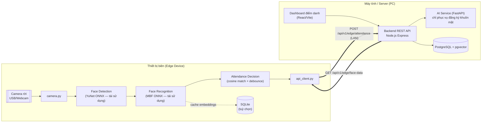
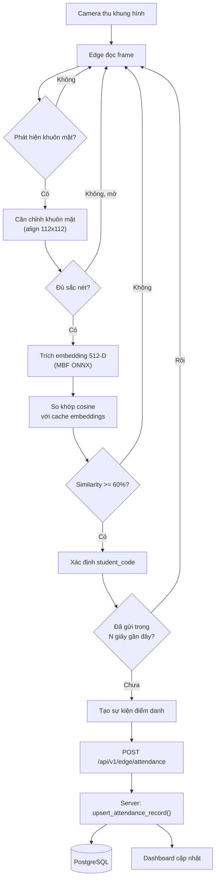
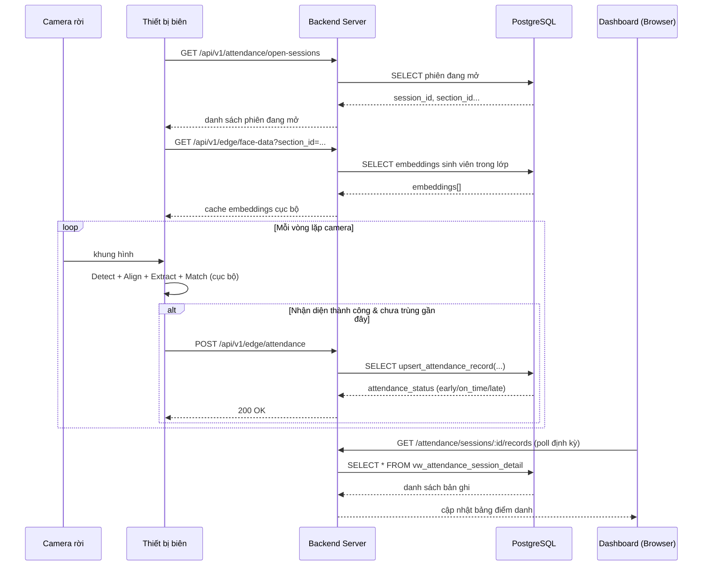

# Phân tích hệ thống hiện tại & Đề xuất kiến trúc PoC AIoT (Edge Face Recognition)

> Tài liệu này phục vụ báo cáo/trình bày với giảng viên. Mọi nhận xét đều dẫn chiếu tới file/class/function cụ thể trong repo `AttendanceSystem`. Phần "HIỆN TRẠNG" mô tả những gì code đang làm; phần "ĐỀ XUẤT" là kiến trúc PoC mới, chưa được cài đặt.

---

## 1. Tổng quan cấu trúc project (hiện trạng)

```
AttendanceSystem/
├── frontend/                     React 18 + Vite 5 + TailwindCSS v4 (JSX thuần)
│   └── src/{App.jsx, pages/, api/client.js, auth/}
├── backend/
│   ├── src/                      Node.js 20 + Express 4 – REST API + DB access
│   │   ├── index.js               entrypoint (port 3001)
│   │   ├── db.js                  pg Pool → PostgreSQL
│   │   ├── upload.js              multer (disk + memory storage)
│   │   ├── middleware/auth.js     JWT/role-based actor middleware
│   │   └── routes/{students,attendance,lecturers,auth}.js
│   ├── ai/                       Python + FastAPI – AI Service (port 8001)
│   │   ├── main.py                2 endpoint: /ai/face/validate, /ai/face/extract
│   │   ├── core/face_engine.py    FaceEngine (detection + recognition + liveness)
│   │   └── model/*.onnx           YuNet, MBF (ArcFace), 2× MiniFASNet
│   └── database/                 PostgreSQL 16 + pgvector, SQL migrations/functions
└── docker-compose.yml            4 service: postgres, ai, backend, frontend
```

Đây là kiến trúc 3 tier chạy hoàn toàn trên PC/server (không có thiết bị biên). Camera hiện tại là **webcam của trình duyệt**, không phải thiết bị phần cứng rời.

---

## 2. Tóm tắt hệ thống hiện tại

### 2.1 Công nghệ & thư viện
| Lớp | Công nghệ | Nguồn |
|---|---|---|
| Frontend | React 18, Vite 5, TailwindCSS v4, axios, react-router-dom | `frontend/package.json` |
| Backend API | Node.js 20, Express 4, `pg`, `multer`, `axios`, `form-data` | `backend/package.json` |
| AI Service | Python, FastAPI, OpenCV (`cv2`), `onnxruntime` (CPUExecutionProvider) | `backend/ai/requirements.txt` |
| Database | PostgreSQL 16 + extension `pgvector` | `backend/database/database/init/001_extensions.sql`, `docker-compose.yml:5` |
| Models AI | `face_detection_yunet_2023mar.onnx`, `w600k_mbf.onnx` (ArcFace/MobileFaceNet, 512-D), `2.7_80x80_MiniFASNetV2.onnx`, `4_0_0_80x80_MiniFASNetV1SE.onnx` | `backend/ai/model/` |

### 2.2 File khởi chạy chính
- Frontend: `frontend/src/main.jsx` → `App.jsx` (router: `/`, `/login`, `/teacher`, `/profile`, `/scan`)
- Backend API: `backend/src/index.js` (Express app, port 3001, mount các router `/api/v1/*`)
- AI Service: `backend/ai/main.py` (`uvicorn main:app --port 8001`)
- Toàn hệ thống: `docker-compose.yml` (root) — 4 container: `postgres`, `ai`, `backend`, `frontend`

### 2.3 Luồng lấy dữ liệu từ camera (hiện trạng)
Camera **chạy trong trình duyệt**, không phải thiết bị riêng:
- `frontend/src/pages/AttendanceScan.jsx:101-110` (`startCamera`) dùng `navigator.mediaDevices.getUserMedia` để mở webcam của máy tính đang chạy trình duyệt.
- `capture()` (dòng 112-136) vẽ khung hình hiện tại của `<video>` lên `<canvas>`, xuất ra `Blob` JPEG rồi `POST` tới `backend` dưới dạng `multipart/form-data` (`frame`, `session_id`).
- Việc chụp được lặp lại tự động bằng `setInterval` phía client (1–5 giây, chọn qua nút "Tần suất") — dòng 138-154.
- ⇒ **Toàn bộ vòng lặp capture nằm ở phía trình duyệt/JS**, backend chỉ nhận ảnh JPEG qua HTTP.

### 2.4 Cách phát hiện khuôn mặt
- Model: `cv2.FaceDetectorYN` (YuNet), khởi tạo 1 lần trong `FaceEngine.__new__` — `backend/ai/core/face_engine.py:16-22`.
- Ngưỡng: `score_threshold=0.80`, `nms_threshold=0.3`.
- Dùng lại instance singleton cho mọi ảnh (`_instance` pattern) để tránh load model nhiều lần.

### 2.5 Cách nhận diện khuôn mặt (recognition)
- **Alignment**: `align_face()` (`face_engine.py:42-49`) dùng 5 landmark điểm để warp affine khuôn mặt về 112×112 theo template ArcFace chuẩn.
- **Chống giả mạo (liveness)**: `check_liveness()` (dòng 79-106) chạy song song 2 model MiniFASNet (crop theo 2 tỷ lệ khác nhau), lấy trung bình softmax, ngưỡng `> 0.60`. Chỉ dùng trong luồng điểm danh realtime (`/ai/face/extract`), **không** dùng trong luồng đăng ký (`/ai/face/validate`).
- **Trích embedding**: `get_face_embedding()` (dòng 140-149) dùng model `w600k_mbf.onnx` qua `onnxruntime`, chuẩn hoá blob `(x-127.5)/127.5`, ra vector 512 chiều, **L2-normalize**.
- **Độ sắc nét**: `calculate_shapeness()` — biến thiên Laplacian, ngưỡng 100.0, dùng để loại ảnh mờ ở cả 2 luồng.
- **So khớp (matching)**: **không nằm trong AI Service** — nằm trong Node backend, `backend/src/routes/attendance.js:630-643`, dùng pgvector: `1 - (fp.embedding <=> $1::vector) AS similarity`, `ORDER BY … LIMIT 1`, ngưỡng chấp nhận `similarityPercent < 60` bị từ chối (dòng 656-664). Đây là điểm quan trọng: **AI Service chỉ trích embedding, việc so khớp là 1 câu SQL trong PostgreSQL** (không phải thư viện Python nào cả).

### 2.6 Cách lưu dữ liệu khuôn mặt
- Bảng `face_profiles` (`backend/database/database/migrations/002_schema.sql:31-41`): `student_id (UNIQUE)`, `image_path`, `embedding VECTOR(512)`, `model_name`, `quality_score`.
- Luồng ghi: `frontend/pages/StudentProfile.jsx` → `POST /students/face/validate` (upload ảnh, gọi AI service `/ai/face/validate`) → FE nhận `embedding` trả về → người dùng bấm lưu → `POST /students/profile` (`backend/src/routes/students.js:227-323`) `INSERT ... ON CONFLICT` vào `students` + `face_profiles` trong 1 transaction.
- Ảnh gốc được lưu vật lý trên đĩa server qua `multer.diskStorage` (`backend/src/upload.js:14-22`, thư mục `backend/uploads/faces/`).

### 2.7 Cách tạo và lưu kết quả điểm danh
- Mô hình nghiệp vụ là **theo phiên (session-based)**, không phải check-in/check-out rời rạc:
  - `attendance_sessions` (giờ bắt đầu/kết thúc, `late_after_minutes`, trạng thái `draft/open/closed/submitted`).
  - `attendance_records` — **UNIQUE (session_id, student_id)** ⇒ mỗi sinh viên chỉ có đúng 1 dòng/phiên (cơ chế chống trùng đã có sẵn ở cấp DB, không cần tự viết logic "check trùng trong khoảng thời gian ngắn" thủ công).
- Toàn bộ logic nghiệp vụ nằm trong PL/pgSQL, **không nằm trong code Node/Python**:
  - `open_attendance_session()` → gọi `bootstrap_attendance_sheet()` để tạo sẵn record `absent` cho toàn bộ sinh viên đã enroll (`003_functions_triggers.sql:44-111`).
  - `compute_attendance_status()` — so `checkin_time` với `start_time`/`late_after_minutes` để ra `early/on_time/late` (dòng 11-42).
  - `upsert_attendance_record()` (dòng 171-278) — hàm trung tâm: kiểm tra phiên đang `open`, kiểm tra sinh viên có `enrollment`, áp ngưỡng `confidence_score < 80` hoặc `sharpness_score <= 100` → tự set `absent`/`low_confidence`/`blurry_rejected`, rồi `INSERT ... ON CONFLICT DO UPDATE ... WHERE is_manual_override = FALSE` (tôn trọng override thủ công của giảng viên).
- Endpoint gọi hàm này: `router.post('/recognize', …)` trong `attendance.js:541-706` — nhận frame → gọi AI `/ai/face/extract` → pgvector search → `SELECT * FROM upsert_attendance_record(...)`.

### 2.8 Giao diện hiện tại hoạt động như thế nào
- `Home.jsx`: trang giới thiệu.
- `StudentProfile.jsx`: sinh viên/admin đăng ký hồ sơ + khuôn mặt (upload ảnh hoặc chụp qua webcam), chọn học phần enrollment.
- `AttendanceScan.jsx` (trang giáo viên/admin dùng để điểm danh): chọn phiên đang mở (`GET /attendance/open-sessions`) → bật webcam → auto-scan → hiển thị log nhận diện realtime + bảng danh sách lớp với trạng thái màu sắc, xuất CSV (`GET /attendance/sessions/:id/export`).
- `TeacherDashboard.jsx`: quản lý phiên điểm danh (tạo/mở/đóng/chốt phiên), override thủ công, xem báo cáo.
- Xác thực: JWT bearer token hoặc header legacy (`X-User-Role`, `X-Lecturer-Code`, `X-Student-Code`) qua `middleware/auth.js`, phân quyền `admin/lecturer/student`.

---

## 3. Đánh giá các phần theo tiêu chí giữ/sửa/chuyển/tách

| Phần | File | Đánh giá |
|---|---|---|
| `FaceEngine` (detect, align, embedding, liveness, sharpness) | `backend/ai/core/face_engine.py` | **Giữ nguyên gần như 100%.** Đây là class thuần Python/OpenCV/onnxruntime, không phụ thuộc FastAPI. Copy sang thiết bị biên và import trực tiếp (không qua HTTP). |
| Các file `.onnx` | `backend/ai/model/*.onnx` | **Giữ nguyên**, copy sang thiết bị biên. `onnxruntime` chạy CPU nên có thể chạy trên ARM (Raspberry Pi, Jetson, Orange Pi) mà không cần sửa code, chỉ cần cài lại `onnxruntime` đúng kiến trúc CPU. |
| `main.py` (FastAPI: `/ai/face/validate`, `/ai/face/extract`) | `backend/ai/main.py` | **Giữ nguyên trên server, KHÔNG xoá.** Vẫn cần cho luồng đăng ký khuôn mặt qua trình duyệt (`StudentProfile.jsx`) — luồng này không chuyển sang edge. Chỉ có luồng *realtime attendance* là chuyển. |
| Vòng lặp capture + auto-scan (JS) | `frontend/src/pages/AttendanceScan.jsx:101-154` | **Phải bỏ khỏi trình duyệt.** Logic `getUserMedia` + `setInterval` capture chuyển thành vòng lặp Python (`cv2.VideoCapture`) chạy trên thiết bị biên. Trang này đổi vai trò: từ "điều khiển camera" → "hiển thị kết quả điểm danh realtime" (chỉ còn polling `GET /sessions/:id/records`). |
| pgvector similarity search | `backend/src/routes/attendance.js:630-643` | **Chuyển 1 phần sang edge.** Việc so khớp (cosine similarity) cần chạy tại chỗ trên thiết bị biên bằng numpy, vì thiết bị biên không có kết nối DB trực tiếp và không nên gửi ảnh thô liên tục qua mạng. Server vẫn giữ vai trò cấp phát embeddings ban đầu (`GET /face-data`). |
| `upsert_attendance_record()`, `compute_attendance_status()`, ràng buộc `UNIQUE(session_id, student_id)` | `003_functions_triggers.sql` | **Giữ nguyên 100%, không sửa.** Đây chính là phần "Attendance Decision" ở tầng nghiệp vụ (early/on_time/late/absent) và chống trùng — đã làm đúng, đủ tốt, và độc lập với nguồn dữ liệu đến từ đâu (browser hay edge). |
| `students.js`, `attendance.js` (trừ đoạn `/recognize` xử lý ảnh), `lecturers.js`, `auth.js`, `db.js`, `middleware/auth.js` | `backend/src/routes/`, `backend/src/` | **Giữ nguyên.** Đây là lớp "server/backend" đúng nghĩa, không đụng đến phần cứng, không cần sửa cho kiến trúc AIoT. |
| Router `/recognize` (nhận ảnh JPEG, gọi AI service, pgvector, upsert) | `attendance.js:541-706` | **Liên kết quá chặt, cần tách.** Hàm này gộp 4 trách nhiệm trong 1 route: (1) nhận ảnh thô, (2) gọi AI service qua HTTP, (3) so khớp SQL, (4) ghi điểm danh. Trong kiến trúc mới, việc (1)+(2)+(3) chuyển sang edge; server chỉ còn nhận **kết quả đã nhận diện** (JSON nhỏ) và gọi lại đúng `upsert_attendance_record()` — tái sử dụng logic có sẵn, không viết lại. |
| React webcam UI (`<video>`, `<canvas>`) | `AttendanceScan.jsx:288-316` | **Cần sửa.** Camera preview biến mất (camera vật lý nằm ở thiết bị biên, không phải máy người xem dashboard). Thay bằng khung hiển thị log/trạng thái realtime lấy từ server (poll hoặc SSE/WebSocket — không bắt buộc cho PoC). |
| Đăng ký khuôn mặt qua webcam trình duyệt | `StudentProfile.jsx` (dùng `videoRef`, `canvasRef`) | **Giữ nguyên.** Đây là tác vụ hành chính một lần (admin/sinh viên đăng ký ảnh), không cần chạy trên thiết bị biên, vẫn hợp lý khi chạy trên PC. |

---

## 4. Kiến trúc PoC đề xuất — 3 thành phần

```
[A. Camera rời] → [B. Thiết bị biên] → HTTP REST (LAN) → [C. Máy tính/Server]
```

### A. Camera rời
- USB camera hoặc webcam gắn trực tiếp vào cổng USB của thiết bị biên.
- Không xử lý gì, chỉ truyền frame thô (giống vai trò `getUserMedia` hiện tại, nhưng nay là `cv2.VideoCapture(0)` phía Python).

### B. Thiết bị biên (Edge Device)
Ví dụ phần cứng: Raspberry Pi 4/5, Jetson Nano/Orin Nano, mini-PC x86, hoặc laptop cũ chạy Linux — miễn chạy được Python + OpenCV + onnxruntime (CPU).

| Module | Vai trò | Nguồn gốc |
|---|---|---|
| Camera Capture | Đọc frame liên tục từ camera | Viết mới (thay thế `getUserMedia`) |
| Face Detection | YuNet | **Tái sử dụng `FaceEngine.detector`** |
| Face Recognition | Align + MBF embedding (+ liveness tuỳ chọn) | **Tái sử dụng `FaceEngine`** gần như nguyên vẹn |
| Attendance Decision | So khớp cosine với cache embeddings cục bộ, lọc trùng trong N giây | Viết mới, logic ngưỡng 60% tham chiếu từ `attendance.js:657` |
| API Client | Gửi kết quả qua HTTP REST | Viết mới |
| Local DB (tuỳ chọn) | Cache embeddings + hàng đợi retry khi mất mạng | Viết mới, SQLite — **không bắt buộc cho PoC** |

### C. Máy tính/Server (giữ nguyên vai trò hiện có)
- Backend REST API (Express) — giữ nguyên, thêm 1–2 route mới.
- AI Service (FastAPI) — **vẫn giữ, chỉ phục vụ đăng ký khuôn mặt**, không còn nằm trên đường đi realtime.
- Database (PostgreSQL + pgvector) — giữ nguyên schema, thêm 1 cột.
- Dashboard (React) — bớt phần điều khiển camera, giữ phần xem/quản lý.

---

## 5. Luồng xử lý cụ thể (đề xuất)

```
Camera thu hình
  → Edge đọc frame (cv2.VideoCapture)
  → Face Detection (YuNet, ngưỡng 0.80 — tái sử dụng nguyên vẹn)
  → Align khuôn mặt 112×112 (align_face() — tái sử dụng nguyên vẹn)
  → Kiểm tra sharpness > 100 (calculate_shapeness() — tái sử dụng)
  → Trích embedding 512-D (get_face_embedding() — tái sử dụng)
  → So sánh cosine với cache embeddings tải từ server (numpy, thay cho pgvector)
  → similarity >= 60% ⇒ xác định student_code
  → Debounce: đã gửi student_code này trong N giây gần đây? (mới, ví dụ 10–15s)
     → Có: bỏ qua, quay lại đọc frame
     → Chưa: tạo sự kiện điểm danh
  → POST /api/v1/edge/attendance (JSON, không kèm ảnh)
  → Server: upsert_attendance_record() — TÁI SỬ DỤNG NGUYÊN VẸN (tính early/on_time/late, chống trùng theo session)
  → Ghi vào attendance_records (PostgreSQL)
  → Dashboard poll GET /sessions/:id/records để cập nhật danh sách
```

Lưu ý quan trọng: việc "tránh điểm danh trùng" có **2 lớp**, không xung đột nhau:
1. **Lớp edge (mới, nhẹ)**: debounce theo thời gian để không spam mạng khi 1 người đứng trước camera nhiều giây liền.
2. **Lớp server (đã có, là nguồn sự thật)**: ràng buộc `UNIQUE(session_id, student_id)` + logic trong `upsert_attendance_record()` mới là nơi quyết định cuối cùng — kể cả nếu edge gửi trùng, DB vẫn không tạo bản ghi trùng.

---

## 6. Đề xuất chia lại source code

```
edge/                              (MỚI — chạy trên thiết bị biên)
├── camera.py                      MỚI — vòng lặp đọc frame từ cv2.VideoCapture
├── face_engine.py                 TÁI SỬ DỤNG gần nguyên vẹn từ backend/ai/core/face_engine.py
│                                   (giữ nguyên detect/align/embedding; liveness giữ hoặc bỏ tuỳ hiệu năng phần cứng)
├── attendance_service.py          MỚI — so khớp cosine cục bộ + debounce trùng + gọi compute logic tối thiểu
├── api_client.py                  MỚI — wrapper requests: get_open_sessions(), get_face_data(), post_attendance()
├── local_database.py              MỚI, TUỲ CHỌN — cache SQLite cho embeddings + hàng đợi khi mất mạng
├── config.py                      MỚI — DEVICE_ID, SERVER_URL, CAMERA_INDEX, SIMILARITY_THRESHOLD=0.60,
│                                   SHARPNESS_THRESHOLD=100.0, DEDUP_SECONDS=10
└── main.py                        MỚI — orchestrator (vòng lặp chính)

backend/
├── ai/                            GIỮ NGUYÊN — vẫn phục vụ /ai/face/validate cho luồng đăng ký trên PC
├── src/
│   ├── routes/
│   │   ├── students.js            GIỮ NGUYÊN
│   │   ├── attendance.js          GIỮ, rút gọn phần liên quan realtime (xem mục 7)
│   │   ├── lecturers.js, auth.js  GIỮ NGUYÊN
│   │   └── edge.js                MỚI — 2 route: POST /attendance, GET /face-data (device-auth riêng)
│   ├── middleware/auth.js         SỬA NHẸ — thêm hàm xác thực device-key cho router edge.js
│   └── db.js, upload.js           GIỮ NGUYÊN
└── database/
    └── .../006_edge_device.sql    MỚI — 1 migration nhỏ: ALTER TABLE attendance_records ADD COLUMN device_id

frontend/
└── src/pages/AttendanceScan.jsx   SỬA — bỏ getUserMedia/canvas/auto-scan, giữ lại: chọn phiên, bảng danh sách,
                                    log realtime (nay lấy từ polling server, không tự chụp ảnh nữa)
```

**Ghi chú:** cấu trúc `edge/` tham khảo theo gợi ý của bạn nhưng đã gộp `face_detector.py` + `face_recognizer.py` thành 1 file `face_engine.py` duy nhất — vì code gốc (`FaceEngine`) vốn đã gộp detection + recognition + liveness trong 1 class, tách ra thêm sẽ là over-engineering không cần thiết cho PoC.

---

## 7. API tối thiểu giữa thiết bị biên và máy tính

Bám theo tiền tố hiện có `/api/v1` để nhất quán với phần còn lại của hệ thống (thay vì `/api/...` như đề xuất gốc):

### `POST /api/v1/edge/attendance`
Gửi 1 sự kiện điểm danh đã được nhận diện xong tại edge.

```json
{
  "device_id": "EDGE_01",
  "session_id": 42,
  "student_code": "SV001",
  "timestamp": "2026-07-11T08:15:30+07:00",
  "similarity": 91.2,
  "sharpness_score": 143.5,
  "liveness_score": 0.87,
  "recognition_status": "matched"
}
```
- Khác với JSON mẫu gốc: **không dùng `status: "check_in"` chung chung** — hệ thống hiện tại tính trạng thái `early/on_time/late/absent` dựa trên `attendance_sessions.start_time` + `late_after_minutes`, nên trường này server tự suy ra qua `compute_attendance_status()`, edge không cần (và không nên) tự quyết.
- Dùng lại `student_code` (không phải `user_id` generic) và thêm bắt buộc `session_id` — vì nghiệp vụ hiện tại là theo phiên học, không phải điểm danh tự do.
- Xử lý phía server: route mới trong `edge.js` chỉ cần lookup `student_id` từ `student_code`, rồi gọi **nguyên hàm** `SELECT * FROM upsert_attendance_record($1,$2,...)` đã có — không viết lại logic nghiệp vụ.

### `GET /api/v1/edge/face-data?section_id=...`
Trả về embeddings cần thiết để edge nhận diện offline.
```json
{
  "status": "success",
  "data": [
    { "student_id": 12, "student_code": "SV001", "full_name": "Nguyễn Văn A", "embedding": [0.0123, -0.045, "...512 phần tử"] }
  ]
}
```
Query tương tự phần JOIN đã có trong `attendance.js:630-643`, chỉ bỏ đoạn `<=>` (vì so khớp nay làm ở edge bằng numpy).

### `GET /api/v1/students` *(dùng lại, không tạo `GET /api/users` mới)*
Endpoint `students.js:60-104` đã trả đủ danh sách người dùng (mã SV, tên, lớp, có/không có face profile). Không cần tạo route trùng lặp — chỉ cần đảm bảo middleware auth chấp nhận request từ thiết bị biên nếu dashboard cần hiển thị lại.

### `GET /api/health` *(đã có sẵn, dùng nguyên)*
`backend/src/index.js:41-43` đã trả `{status:"ok", service:"...", timestamp:...}`. Edge dùng để kiểm tra kết nối server trước khi bắt đầu vòng lặp.

**Xác thực cho thiết bị biên:** vì đây là thiết bị không đăng nhập như người dùng, không dùng JWT login — dùng 1 **device key tĩnh** (ví dụ header `X-Device-Key`, so khớp với biến môi trường `EDGE_DEVICE_KEY` trên server) áp cho router `edge.js`. Đơn giản, đủ cho PoC, không cần OAuth/mTLS.

---

## 8. Database tối thiểu — ánh xạ vào schema hiện có

Không tạo bảng mới song song — **tái sử dụng schema đã có**, vì đã đủ tốt và đã có sẵn logic nghiệp vụ (status/dedup) hoạt động đúng:

| Đề xuất gốc | Thực tế trong project | Khuyến nghị |
|---|---|---|
| `users` | `students` (`002_schema.sql:20-29`) | Giữ nguyên |
| `face_embeddings` | `face_profiles` — `embedding VECTOR(512)` (dòng 31-41) | Giữ nguyên |
| `attendance_events` | `attendance_sessions` + `attendance_records` (dòng 61-104) | Giữ nguyên toàn bộ mô hình theo phiên (session-based), **không đơn giản hoá** thành check-in/check-out rời rạc — sẽ phá vỡ logic `early/on_time/late` đã hoạt động tốt |
| trường `device_id` | **chưa tồn tại** | Thêm 1 migration nhỏ: |

```sql
-- backend/database/database/migrations/006_edge_device.sql
ALTER TABLE attendance_records
  ADD COLUMN device_id VARCHAR(50);
```

Đây là thay đổi DB **duy nhất** cần cho PoC.

---

## 9. Sơ đồ Mermaid

### 9.1 Kiến trúc tổng thể



### 9.2 Luồng xử lý nhận diện & điểm danh



### 9.3 Sequence diagram



---

## 10. Phương án kết nối mạng

| | Phương án 1: LAN qua router/switch | Phương án 2: Ethernet trực tiếp, IP tĩnh |
|---|---|---|
| Ưu điểm | Dễ mở rộng sau này (nhiều thiết bị/nhiều phòng); cả 2 máy vẫn có Internet; dễ thao tác qua Wi-Fi nếu cần | Độ trễ thấp, ổn định nhất cho buổi demo trực tiếp; không phụ thuộc router/DHCP của phòng học; đơn giản, không có nhiễu mạng từ thiết bị khác |
| Nhược điểm | IP có thể đổi nếu router cấp DHCP động (khắc phục bằng DHCP reservation); phụ thuộc hạ tầng mạng có sẵn của phòng học | Không mở rộng được nếu sau này thêm thiết bị thứ 2 (cần switch); cả 2 máy phải cấu hình IP tĩnh cùng subnet thủ công |
| Khuyến nghị cho PoC | Dùng khi demo tại phòng lab có sẵn mạng ổn định | **Khuyến nghị dùng khi trình bày với giảng viên** — tránh rủi ro Wi-Fi/router phòng học chập chờn giữa buổi báo cáo |

Cả 2 phương án đều không cần MQTT broker hay cloud — HTTP REST thuần qua LAN là đủ cho quy mô 1 camera – 1 edge – 1 server.

---

## 11. Lộ trình chuyển đổi

| Bước | Nội dung | File liên quan |
|---|---|---|
| 1 | Tách logic nhận diện khỏi giao diện: xác nhận `FaceEngine` có thể chạy độc lập không cần FastAPI | `backend/ai/core/face_engine.py` (đã độc lập sẵn — chỉ cần copy) |
| 2 | Viết `edge/camera.py` + `edge/main.py`, chạy thử nhận diện offline trên thiết bị biên (chưa gọi server) | mới: `edge/` |
| 3 | Thêm route `backend/src/routes/edge.js` (`POST /attendance`, `GET /face-data`) + migration `device_id` | `backend/src/routes/edge.js`, `006_edge_device.sql` |
| 4 | Nối `edge/api_client.py` gọi 2 route trên qua LAN | `edge/api_client.py` |
| 5 | Xác nhận `upsert_attendance_record()` nhận đúng dữ liệu từ nguồn mới, không cần sửa hàm SQL | `003_functions_triggers.sql` (không sửa) |
| 6 | Sửa `AttendanceScan.jsx`: bỏ webcam/canvas, chuyển sang hiển thị kết quả qua polling | `frontend/src/pages/AttendanceScan.jsx` |
| 7 | Kiểm thử kết nối LAN (đo độ trễ, mất gói), đo FPS/thời gian suy luận trên phần cứng biên thực tế | — |

---

## 12. Kết luận

### Kiến trúc PoC được khuyến nghị
Camera rời → Thiết bị biên (chạy lại nguyên `FaceEngine` cục bộ, không gọi AI Service qua mạng) → HTTP REST/LAN (JSON nhẹ, không gửi ảnh) → Backend Express hiện có (tái sử dụng gần như toàn bộ) → PostgreSQL/pgvector hiện có (tái sử dụng 100% schema + hàm nghiệp vụ) → Dashboard React hiện có (bỏ phần điều khiển webcam).

### Module cần giữ lại (không đụng vào)
- `backend/ai/core/face_engine.py` — copy nguyên sang edge
- `backend/ai/model/*.onnx` — copy nguyên sang edge
- `backend/ai/main.py` — vẫn chạy trên server cho luồng đăng ký
- `backend/database/database/migrations/003_functions_triggers.sql` — toàn bộ hàm PL/pgSQL
- `backend/src/routes/students.js`, `lecturers.js`, `auth.js`, `db.js`, `upload.js`
- `frontend/src/pages/StudentProfile.jsx`, `TeacherDashboard.jsx`

### Module cần sửa
- `frontend/src/pages/AttendanceScan.jsx` — bỏ `getUserMedia`/`canvas`/auto-scan JS, chuyển sang hiển thị realtime qua polling
- `backend/src/routes/attendance.js` — bớt trách nhiệm xử lý ảnh trong `/recognize` (giữ lại như một chế độ dự phòng "quét từ máy tính" nếu muốn, không bắt buộc xoá)
- `backend/src/middleware/auth.js` — thêm xác thực device-key cho route edge

### File mới cần tạo
- `edge/{camera.py, face_engine.py, attendance_service.py, api_client.py, config.py, main.py}` (+ `local_database.py` nếu muốn cache SQLite)
- `backend/src/routes/edge.js`
- `backend/database/database/migrations/006_edge_device.sql`

### Thứ tự triển khai
Xem mục 11 (7 bước) — bắt đầu từ chạy được nhận diện offline trên thiết bị biên, rồi mới nối API, cuối cùng mới sửa giao diện.

### Chưa cần làm ở giai đoạn PoC
- Không cần MQTT broker, message queue
- Không cần Kubernetes/microservices orchestration
- Không cần quản lý nhiều thiết bị biên/nhiều địa điểm
- Không cần OTA cập nhật model từ xa
- Không cần mTLS/OAuth2 cho thiết bị — device-key tĩnh là đủ
- Không bắt buộc SQLite cache trên edge (chỉ nên có nếu còn thời gian, để demo khả năng chịu lỗi mất mạng)
- Không cần WebSocket — polling định kỳ (`GET /sessions/:id/records`) đã đủ cho PoC (được ghi rõ là TODO tương lai trong `document.md:261`, không phải yêu cầu bắt buộc)
